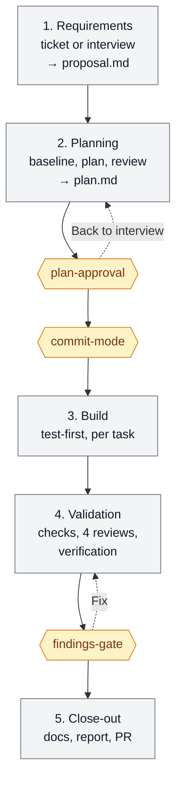
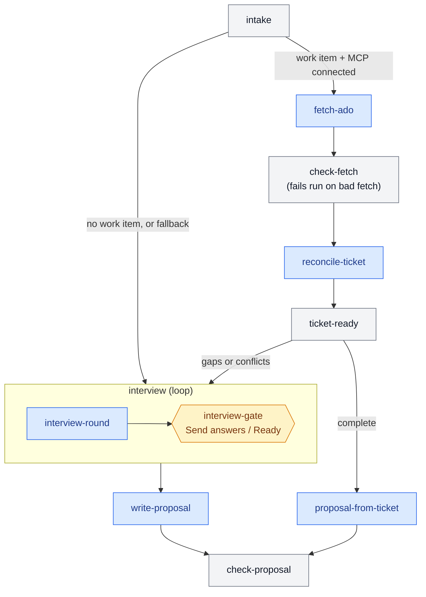
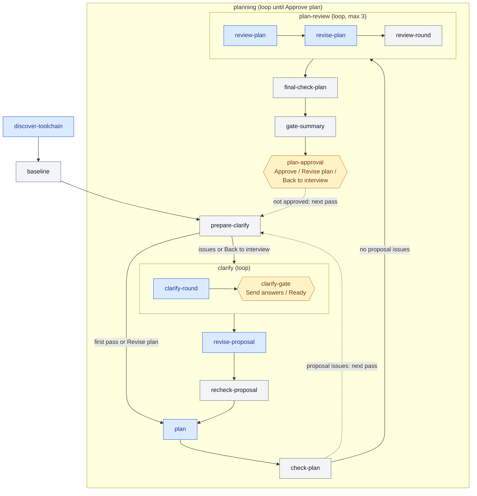
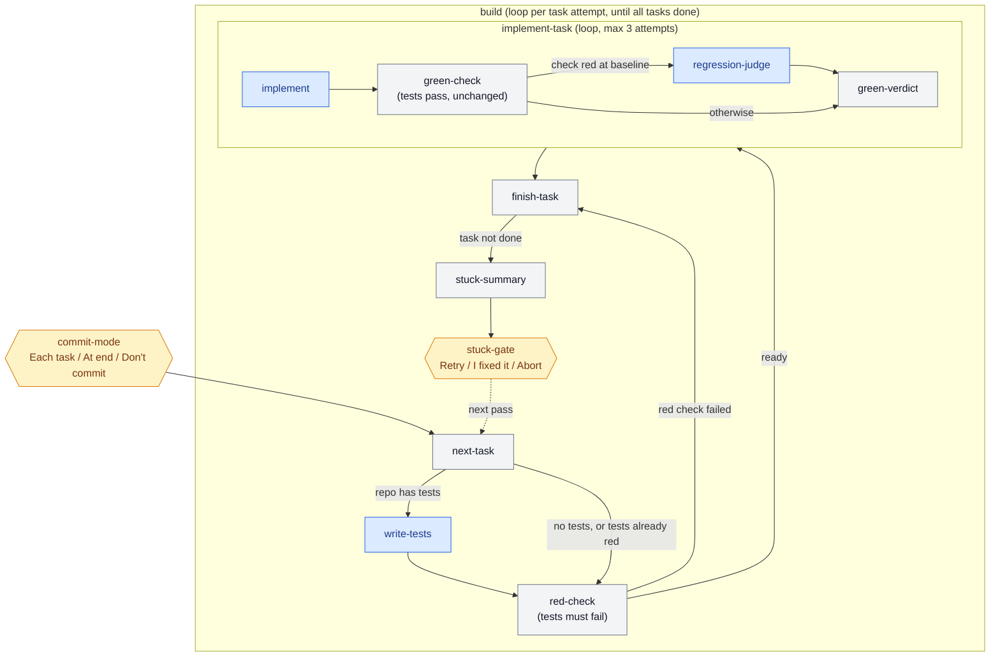
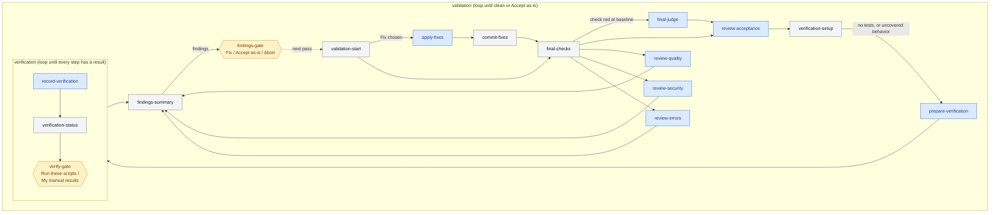
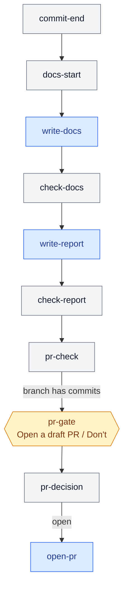

# Archon `code-task` workflow

An interactive [Archon](https://archon.diy) workflow for general coding tasks.
It takes a change from requirements to a validated, reviewed result on its own
branch:

1. Gather requirements from an Azure DevOps work item or an interview.
2. Plan the work, with independent review and your approval.
3. Build test-first, one task at a time.
4. Validate with four separate reviews and verification steps.
5. Write the glossary, ADRs, and a report, and optionally open a draft PR.

It pauses at gates for your decisions, so it runs in the foreground.

The workflow is generic. It discovers each repository's own test, lint, build,
and typecheck commands instead of assuming a toolchain.

## Where it lives

| Source (this repo) | Deployed to |
|---|---|
| `home/dot_archon/workflows/dev/code-task/code-task.yaml.tmpl` | `~/.archon/workflows/dev/code-task/code-task.yaml` |
| `home/dot_archon/workflows/dev/code-task/commands/*.md` | AI prompts, one per AI node |
| `home/dot_archon/workflows/dev/code-task/scripts/*.ts` | Deterministic gates and glue (Bun) |
| `home/dot_archon/workflows/dev/code-task/fixtures/*.stubs.yaml` | Dry-run fixtures |
| `home/dot_archon/workflows/dev/dot_shared/*.ts` | Pack-level shared modules (`.shared/`) |

The YAML is a chezmoi template only so that it can read one value: the default
Azure DevOps project, from the `AZURE_PROJECT` secret in Doppler (project
`personal`, config `default`). This is the same way the `azure-ado` MCP server
gets `AZURE_ORG`. Leave the secret unset if you don't use Azure DevOps; the
default is then empty.

## Running it

```bash
archon workflow run code-task --branch my-change "Add retry to the uploader"
```

With an Azure DevOps work item:

```bash
archon workflow run code-task --branch task-4521 "AB#4521"
```

Interactive workflows refuse `--detach` on a fresh launch. Run it in the
foreground (or as a background task of your harness), then answer each gate
with `archon workflow approve`.

### Inputs

| Input | Default | Purpose |
|---|---|---|
| `work_item` | `""` | ADO work item ID (`1234`) or URL. Overrides any reference in the message. |
| `ado_project` | Doppler `AZURE_PROJECT` | ADO project for bare IDs and `AB#` references. |

### Work item references

Archon checks these in order. The first match wins:

1. `--input work_item=1234`, or `--input work_item=<work item URL>`
2. A work item URL in the message:
   `https://dev.azure.com/{org}/{project}/_workitems/edit/1234` or
   `https://{org}.visualstudio.com/{project}/_workitems/edit/1234`
3. `AB#1234` in the message

A bare `#1234` is **not** treated as a work item, so "fix the bug from #12" is
never misread.

### Prerequisites

- `archon` and `bun` on `PATH` (both managed through mise).
- The Claude provider. The ADO fetch and the PR step use Claude's user-level
  MCP servers.
- Optional: the `azure-ado` MCP server from `ai-tools.yaml`. If it's missing or
  disconnected, the workflow falls back to the interview and says why.
- The `gh` CLI, only if you want draft PRs opened on GitHub.

## The nodes

The run moves through five stages. Each stage has its own chart below. In
every chart, **blue** is an AI node, **grey** is a deterministic script, and an
**amber hexagon** is a gate where you decide. A box labelled *loop* repeats as
a unit (an Archon `loop_group`).



### 1. Requirements

Every path ends in one `proposal.md`, the single brief the rest of the run
works from. This stage is read-only.



| Node | Type | What it does |
|---|---|---|
| `intake` | script | Parses the work item reference and resolves the ADO project. Probes `claude mcp get azure-ado`. Routes to `ado` or `interview`; a failed probe or a missing project falls back to the interview with a stated reason. |
| `fetch-ado` | AI (small, read-only ADO tools) | Transcribes the work item, its parent and children, related titles, and the last 20 comments into `work-item.md`. Reports gaps. |
| `check-fetch` | script | **Fails the run** if the fetch failed (not found, auth, wrong org). Writes `ticket-gaps.md`. |
| `reconcile-ticket` | AI | Checks the ticket against the code, the context files, the glossary, and the ADRs. Reports only conflicts it can cite on both sides. |
| `ticket-ready` | script | `complete` = no gaps and no conflicts. |
| `interview` | loop | Grilling-style rounds: the frontier of open decisions, each with a recommended answer. Starts with read-only recon of the context files, glossary, and ADRs. In *ticket-review* mode it confirms each acceptance criterion, then the gaps, then the conflicts. Ends only when you choose **Ready**. |
| `write-proposal` / `proposal-from-ticket` | AI | Write `proposal.md`: acceptance criteria as `### AC-n` GIVEN/WHEN/THEN scenarios, invariants, goals and non-goals, decisions, glossary and ADR candidates. |
| `check-proposal` | script | Validates the AC format and unique IDs, and that the worktree is unchanged. |

### 2. Planning



| Node | Type | What it does |
|---|---|---|
| `discover-toolchain` | AI (small, read-only) | Finds the repo's declared test, lint, build, and typecheck commands, plus `has_tests`. Never invents a command. |
| `baseline` | script | Runs those commands on the untouched branch. **Pre-existing failures are recorded, not fatal**; later stages judge only new failures. |
| `planning` | loop | One pass: clarify (only when reopened), plan, `check-plan`, review, and your approval. Repeats until you choose **Approve plan**. |
| `plan` | AI (large) | One task per test-first cycle (`### T-n`), each with Files, Satisfies (`AC-n`), Tests (or Verification steps when the repo has no tests), Depends on, and Done when. Blocking problems go under `## Proposal issues`. |
| `check-plan` | script | Every AC is covered, references are valid, required fields are present. Proposal issues send the next pass back to clarification. |
| `plan-review` | loop (max 3) | An independent fresh-context reviewer, plus a reviser. **After 3 rounds it hands open findings to your gate** instead of failing. |
| `plan-approval` | gate | **Approve plan** / **Revise plan** (your text is feedback) / **Back to interview**. |

### 3. Build



| Node | Type | What it does |
|---|---|---|
| `commit-mode` | gate | Asked once, before any code: **Commit after each task** / **Commit once at the end** / **Don't commit**. |
| `next-task` | script | Picks the next task in dependency order, carries stuck-gate guidance forward, and acts on **Abort**. |
| `write-tests` | AI | Writes only the task's tests and declares a targeted test command. |
| `red-check` | script | Only the declared test files changed, and the targeted tests **fail**. Records the test file hashes. |
| `implement-task` | loop (max 3) | `implement` (AI), then `green-check`: the targeted tests pass **with the test files unchanged**; checks that passed at baseline still pass; checks that failed at baseline go to `regression-judge` (AI), which compares the logs. |
| `finish-task` | script | Marks the task done and commits it if per-task commits were chosen. |
| `stuck-gate` | gate | After 3 failed attempts, or a red check that couldn't be satisfied: **Retry with guidance** / **I fixed it, re-check** / **Abort run**. |

Repos without tests skip the test steps. Lint, build, and typecheck still run
after every task.

### 4. Validation



| Node | Type | What it does |
|---|---|---|
| `validation-start` | script | Acts on the previous findings gate: records **Fix** direction, or ends the run on **Abort**. |
| `apply-fixes` / `commit-fixes` | AI / script | Fix only what you chose. Committed if you chose per-task commits. |
| `final-checks` (+ `final-judge`) | script (+ AI) | Every check over the whole change, against the baseline. Also fails if any proven-failing test was edited. |
| `review-acceptance` | AI (large) | Traces each `AC-n` to evidence, checks invariants and scope, and **lists behavior no test covers**. |
| `review-quality` | AI | Fit with conventions, reuse, simplicity, clarity, test quality. |
| `review-security` | AI (large) | Injection, secrets, authorization, input validation, unsafe defaults, dependencies, data exposure. |
| `review-errors` | AI | Swallowed errors, propagation, failure paths, edge cases, resource cleanup. |
| `verification` | loop | For repos without tests, and for behavior no test covers. Each step has manual instructions and, where possible, an *explained* script. **Nothing runs unless you ask.** Passed steps keep their result across fix passes. |
| `findings-gate` | gate | Findings grouped by review: **Fix** (optionally say which) / **Accept as-is** / **Abort run**. It also flags verified steps whose files a fix touched. |

The four reviews run in parallel, each from its own command file
(`review-*.md`), so you can tune each one independently.

### 5. Close-out



| Node | Type | What it does |
|---|---|---|
| `commit-end` | script | The single commit, if you chose **Commit once at the end**. It runs after validation, so it includes the fixes. |
| `write-docs` + `check-docs` | AI + script | Updates `$DOCS_DIR/GLOSSARY.md` and writes ADRs to `$DOCS_DIR/adr/`. The AI decides what qualifies as an ADR: hard to reverse, surprising without context, and a real trade-off. Confined to `$DOCS_DIR` and **never committed**. |
| `write-report` + `check-report` | AI + script | `report.md`: summary, every AC with its evidence, tests added, checks, verification, accepted findings, commits, docs, and branch. |
| `pr-check` / `pr-gate` / `open-pr` | script / gate / AI | Only when the branch has commits: **Open a draft PR** / **Don't open a PR**. Opening one pushes the branch. Supports GitHub (`gh`) and Azure DevOps (ADO MCP). |

## Gates you'll see

| Gate | When | Choices |
|---|---|---|
| `interview-gate` | Each interview round | Send answers / Ready: write proposal |
| `clarify-gate` | When planning reopens requirements | Send answers / Ready: update proposal |
| `plan-approval` | Each planning pass without proposal issues | Approve plan / Revise plan / Back to interview |
| `commit-mode` | Once, before building | Commit after each task / Commit once at the end / Don't commit |
| `stuck-gate` | A task that can't be completed | Retry with guidance / I fixed it, re-check / Abort run |
| `verify-gate` | Pending verification steps | Run these scripts (step IDs or `all`) / Here are my manual results |
| `findings-gate` | Validation found something | Fix / Accept as-is / Abort run |
| `pr-gate` | The branch has commits | Open a draft PR / Don't open a PR |

## Guarantees enforced in code

These checks are scripts, not AI judgment:

- Requirements gathering and planning never change the worktree.
- A failed ADO fetch fails the run. It is never silently replaced.
- Every acceptance criterion has an ID, GIVEN/WHEN/THEN lines, and at least one
  planned task.
- A task's tests are written before its code, touch only test files, and fail
  before implementation.
- An implementation passes only with its proven-failing tests **unchanged**.
- Checks that passed at baseline must keep passing. Pre-existing failures never
  count against the change.
- Commits never include `$DOCS_DIR` or files left behind by the baseline.
- The workflow never writes to the Azure DevOps board. The PR description names
  the work item in plain text, not with `AB#`.
- The run always works in its own worktree (`worktree.enabled: true`).

## Artifacts

Everything lands in the run's `$ARTIFACTS_DIR`:

| File | Produced by |
|---|---|
| `work-item.md`, `ticket-gaps.md`, `ticket-conflicts.md` | ADO path |
| `interview-notes.md`, `clarify-notes.md` | Interview and clarification rounds |
| `proposal.md` | The brief; the contract for the whole run |
| `baseline.md`, `baseline-<check>.log` | Baseline run |
| `plan.md`, `plan-review.md` | Planning |
| `build-state.json`, `current-task.md`, `green-report.md`, `*.log` | Build and validation checks |
| `findings.md`, `verification.md` | Validation |
| `report.md` | Final report (also the workflow's returned output) |

## Customizing

**Prompts.** Edit `commands/<node>.md`. The review prompts are separate on
purpose, so you can tighten quality, security, or error handling on its own.

**Gates and wiring.** Edit `code-task.yaml.tmpl`. Load errors show up in:

```bash
archon workflow list
```

The 18 fixtures cover every routing branch without AI spend:

```bash
archon workflow test code-task
```

**Method credits.** The interview adapts `grilling` and `domain-modeling` from
[mattpocock/skills](https://github.com/mattpocock/skills) (MIT) and
`brainstorming` from [obra/superpowers](https://github.com/obra/superpowers).
The text is vendored, so behavior is pinned to this repo rather than to whatever
skill versions are installed.

**Engineering discipline.** The planning, test-writing, implementation, fix,
and review prompts carry a paraphrased form of the guidelines in
[multica-ai/andrej-karpathy-skills](https://github.com/multica-ai/andrej-karpathy-skills/blob/main/CLAUDE.md):

| Guideline | Where it lives |
|---|---|
| Think before coding: state assumptions, don't pick an interpretation silently, push back on needless complexity | `interview` and `clarify` put interpretations to you as questions. `plan` records an `## Assumptions` section, which the plan-approval gate shows you. `write-tests`, `implement`, and `apply-fixes` state their assumptions in their output or in test comments, since they run unattended. |
| Simplicity first: minimum code, nothing speculative | `plan`, `revise-plan`, `implement`, `apply-fixes`, `write-tests`; checked by `review-plan` and `review-quality`. `review-errors` will not ask for handling of impossible scenarios. |
| Surgical changes: every changed line traces to the task | `plan` (no cleanup tasks), `implement`, `apply-fixes`, `write-tests`; checked by `review-plan` and `review-quality`. |
| Goal-driven execution: verifiable success criteria | Built into the workflow: test-first tasks with `Done when` conditions, deterministic red and green checks. `implement` also lists its edits with the check that proves each one before starting. |

## Known limitations

- **Dry runs evaluate each loop once.** Fixtures prove routing within a pass, but
  second passes (interview rounds, a planning bounce, a stuck-gate retry,
  validation fix passes) are proven only by real runs.
- **Two load warnings** on `stuck-gate` and `verify-gate` are expected. Their
  answers are acted on by the next pass (`next-task`, `record-verification`)
  rather than by the loop's exit check, so Retry and Re-check can continue the
  loop.
- **Abort** ends the run as *failed* with an explicit message. Archon requires a
  loop's gate to be its last node, so a cancel step can't follow it.
- The prompts are a first version. Refine them from what real runs show.
